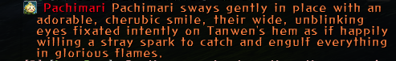
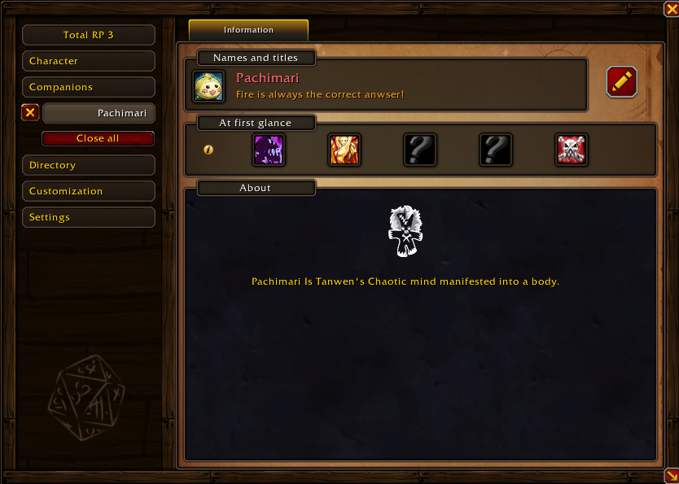
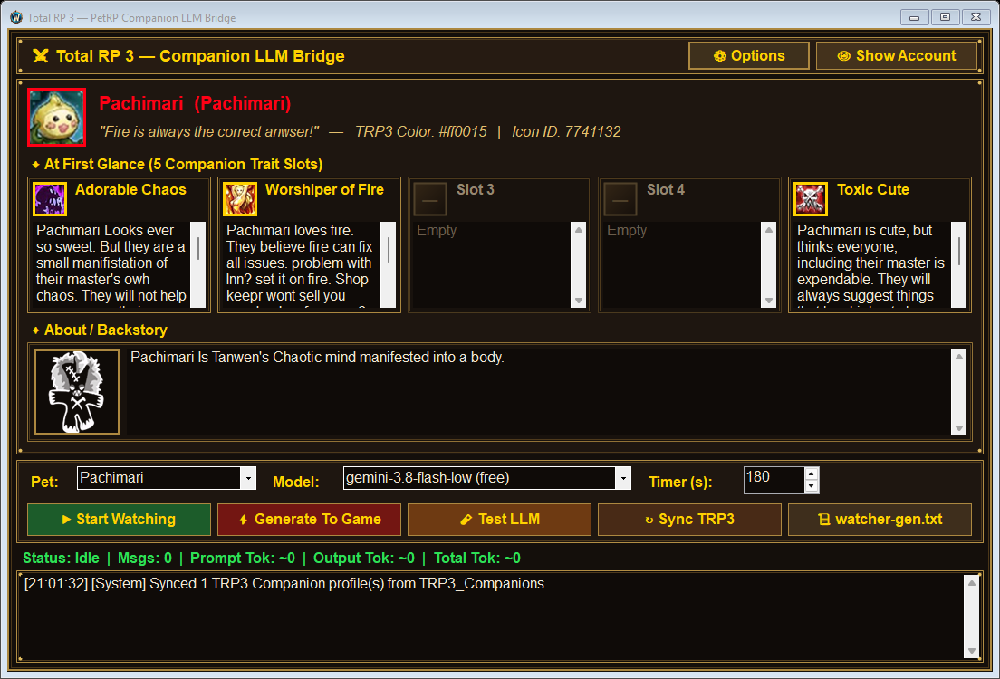
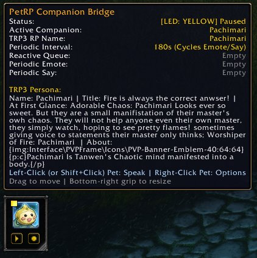
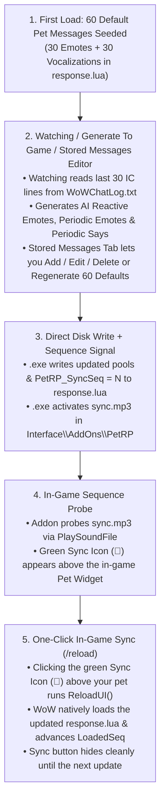

# PetRP — World of Warcraft Total RP 3 Companion LLM Bridge (`v0.8.0`)

**PetRP** brings your World of Warcraft companion pets to life using your **Total RP 3 (TRP3)** companion profiles and the **Google Antigravity CLI (`agy`)**. It combines a lightweight in-game WoW addon (`PetRP`) with a native, TRP3-themed Windows desktop bridge (`PetRP-Companion.exe` compiled from `PetRPCompanion.cs`).

---

## Screenshots

### 1. In-Game Companion Roleplay Message (`PetRP` + `Total RP 3`)


### 2. Total RP 3 Companion Profile (Source Persona for LLM Generation)


### 3. Desktop Companion Bridge (`PetRP-Companion.exe`)


### 4. In-Game Companion Bar & TRP3 Persona Tooltip (`PetRP` Addon)


---

## 1. Required In-Game WoW Addons

| Addon | Requirement | Purpose |
| :--- | :--- | :--- |
| **[Total RP 3 (`totalRP3`)](https://www.curseforge.com/wow/addons/total-rp-3)** | **Required** | Provides your companion's **RP Name**, **Custom Hex Color**, **Icon**, **5 "At First Glance" trait slots**, and **About / Backstory** (`TRP3_Companions`), and renders in-game companion speech/emotes using TRP3's `\|\| ` NPC/Companion chat prefix with your pet's icon and colored name. |
| **[Musician (`Musician`)](https://www.curseforge.com/wow/addons/musician)** | *Optional (Auto-Detected)* | If installed and enabled, `PetRP` uses `Musician.Sampler.PlayNote` on every 3rd periodic cycle to play a subtle, local-only 2-note musical motif when your pet makes a sound. |

---

## 2. Required System Software (for `PetRP-Companion.exe`)

1. **Windows 10 or Windows 11**:
   - Ships with **.NET Framework 4.x** and the C# compiler (`C:\Windows\Microsoft.NET\Framework64\v4.0.30319\csc.exe`) pre-installed out of the box. No Visual Studio or third-party NuGet packages are required.
2. **[Google Antigravity CLI (`agy`)](https://antigravity.google/docs/cli/reference)**:
   - Used by `PetRP-Companion.exe` to generate in-character companion emotes and vocalizations tailored to your pet's TRP3 profile and recent in-character chat.
   - Verify and sign in once via PowerShell or Command Prompt:
     ```powershell
     # Verify agy is installed:
     agy --help

     # Authenticate with your Google account (first run):
     agy

     # List available free & Pro models:
     agy models
     ```
3. **[OpenDyslexic Font](https://opendyslexic.org/)**:
   - Bundled in the `fonts\` folder (and automatically downloaded on startup if missing) so `PetRP-Companion.exe` renders with **OpenDyslexic** out of the box. Can also be installed directly into World of Warcraft via **`⚙ Options` → `🔤 Install OpenDyslexic to WoW`**.

---

## 3. How to Compile `PetRP-Companion.exe` from Source

You can compile `PetRP-Companion.exe` locally in one step using Windows' built-in .NET Framework compiler.

### Option A: One-Click Build via `compile.bat` (Recommended)
Double-click **`compile.bat`** in Windows Explorer, or run it from PowerShell / Command Prompt:
```powershell
.\compile.bat
```
`compile.bat` compiles `PetRPCompanion.cs` into `PetRP-Companion.exe` and embeds `app.ico` as the executable's application icon.

### Option B: Manual PowerShell Compile Command
If you prefer to invoke `csc.exe` directly:
```powershell
C:\Windows\Microsoft.NET\Framework64\v4.0.30319\csc.exe /nologo /target:winexe /win32icon:"app.ico" /out:"PetRP-Companion.exe" /r:System.dll /r:System.Core.dll /r:System.Drawing.dll /r:System.Windows.Forms.dll /r:System.Net.Http.dll "PetRPCompanion.cs"
```

---

## 4. Where the WoW Addon Gets Installed & Automatic Update Detection

The in-game addon files are installed into your World of Warcraft client's `Interface\AddOns\PetRP` directory:

```text
<Your World of Warcraft Folder>\_forever_\Interface\AddOns\PetRP\
├── PetRP.toc
├── core.lua
├── ui.lua
├── response.lua
├── sync1.mp3 .. sync64.mp3
└── fonts\
    ├── OpenDyslexic-Regular.ttf
    └── OpenDyslexic-Bold.ttf
```
*(Supports `_forever_`, `_retail_`, `_classic_`, `_classic_era_`, `_ptr_`, or standalone WoW root folders.)*

### Automatic Install & Outdated Addon Detection
- **Auto-Detection**: On startup, `PetRP-Companion.exe` automatically locates your World of Warcraft client folder by checking running `Wow.exe` processes, Battle.net configuration (`%APPDATA%\Battle.net\Battle.net.config`), the Windows Registry, and standard game directories across all drives.
- **Startup Version & File Check**: Every time `PetRP-Companion.exe` starts, it compares the installed `Interface\AddOns\PetRP` version (`## Version:` in `PetRP.toc` and file contents of `core.lua` / `ui.lua`) against the bundled `PetRP\` folder. If the addon is missing or outdated, it prompts you to install or update it in one click.
- **Manual Reinstall or Folder Selection**: Open **`⚙ Options`** in the top bar of `PetRP-Companion.exe` at any time to browse for a custom WoW folder or click **`📦 Install / Reinstall WoW Addon (PetRP)`**.

---

## 5. How PetRP Works (End-to-End Architecture)



### Zero Keystrokes, Zero Clipboard Hijacking, Zero Custom Channels
- **No Simulated Keys**: `PetRP-Companion.exe` never sends `Ctrl+C`, `Ctrl+V`, `Enter`, or any other keystrokes to your game window.
- **No Custom In-Game Channels**: `PetRP` never joins or sends messages to any custom or hidden WoW chat channels.
- **Sequence-Numbered Signal Files (`sync1.mp3 .. sync64.mp3`)**: Because WoW's audio engine caches `.mp3` filenames in RAM once played, `response.lua` tracks a sequence counter (`PetRP_SyncSeq = N`), and `PetRP` only probes `sync<N+1>.mp3`. When you click the green **Sync (`🔄`)** button above your pet, it executes `ReloadUI()`, loads your new messages from `response.lua`, and advances to watching the next unused `sync<N+1>.mp3` slot—so the Sync button never gets stuck on after reloading.

### True Random Message Selection (AI + Default Pools Preserved)
- **Combined Pool Sampling**: Both custom AI messages (`PetRP_EmotePool`, `PetRP_SayPool`) and the 60 built-in/tailored default messages (`PetRP_DefaultEmotes`, `PetRP_DefaultSays`) are kept intact in memory—speaking a message never drains your AI pool counts.
- **Random Emote or Say on Click**: Clicking your pet's icon in-game (`PetRP.Speak()`) or typing `/petrp` first checks if there is a fresh unread **Reactive Emote** (from someone mentioning your pet's name in chat). Otherwise, it randomly rolls between an **Emote** and a **Say** and picks a random message from the combined `AI + Default` pool while avoiding back-to-back repeats.

---

## 6. Step-by-Step Usage Guide

### Step 1: Set Up Your Companion Profile in Total RP 3
1. Log into World of Warcraft with **Total RP 3** and **PetRP** enabled in your AddOns list.
2. Summon your companion pet and bind it to a **Total RP 3 Companion Profile** (set its **RP Name**, **Custom Color**, **Title**, **Icon**, **5 At First Glance** slots, and **About / Backstory**).
3. Type `/reload` (or log out once) so WoW saves your updated `totalRP3.lua` profile to disk.

### Step 2: Enable WoW Live Chat Logging
In-game, turn on live chat logging so `PetRP-Companion.exe` can read incoming roleplay chat when **Start Watching** is active:
```text
/chatlog
```
*(Note: `PetRP` also automatically enables `LoggingChat(true)` on login/reload.)*

### Step 3: Launch `PetRP-Companion.exe`
1. Open **`PetRP-Companion.exe`**.
2. Click **`↻ Sync TRP3`** if you recently updated your pet's TRP3 profile. Your pet's icon, custom name color, 5 **At First Glance** trait boxes, and **About / Backstory** box will appear.
3. Choose an LLM model from the **Model** dropdown (defaults to free-tier Flash models such as `gemini-3.8-flash-low (free)`).
4. Use any of the generation modes:
   - **`▶ Start Watching`**: Watches `Logs\WoWChatLog.txt` in real time, generating a **Reactive Emote** whenever your pet's name or RP name is mentioned in IC chat, plus 1 new **Periodic Emote / Say** on your timer interval.
   - **`⚡ Generate To Game`**: Immediately generates a single new AI Emote or Say using recent IC chat context and writes it to `response.lua`.
   - **`🧪 Test LLM`**: Generates a preview reaction in the `.exe` log window without modifying `response.lua`.

### Step 4: Manage Stored Messages & Sync In-Game
1. **`💬 Stored Messages (Add / Edit / Delete)` Tab**:
   - View all stored messages across every pool (`REACT`, `EMOTE`, `SAY`, `DEFEMOTE`, `DEFSAY`).
   - Select any message to edit (`💾 Save Edit to Selected`), delete (`🗑 Delete Selected`), or add a custom line (`➕ Add Message`).
   - Click **`🔄 Regenerate 60 Defaults (Replaces All)`** to generate 60 brand-new default messages (30 Emotes + 30 Says) tailored specifically to your pet's TRP3 profile.
2. **Click the Green Sync Button (`🔄`) Above Your Pet In-Game**:
   - Whenever new AI messages are generated or you edit/regenerate messages in `.exe`, the green **Sync (`🔄`)** button appears above your pet widget in WoW.
   - Click the green **Sync (`🔄`)** button to run `ReloadUI()` and load all new messages into WoW.

---

## 7. In-Character (IC) Chat Context Filter (Last 30 Messages)

When generating companion reactions, `PetRP-Companion.exe` reads up to the **last 30 In-Character (IC) messages** from `Logs\WoWChatLog.txt`:
- **Included (In-Character)**:
  - **Local (`/say`)**
  - **Emotes (`/e`, text emotes, and TRP3 `||` companion emotes)**
  - **Yell (`/yell`)**
  - **Party (`/p`)**
  - **Raid (`/raid`, `/rw`)**
- **Excluded (Out-of-Character / OOC)**:
  - **Guild (`[Guild]`, `[G]`)** and **Officer (`[Officer]`, `[O]`)** messages are strictly ignored as OOC.
  - **Whispers**, **General / Trade / World / LFG** channels, explicit OOC brackets (`(( ... ))`, `[OOC]`), and system/loot notices are also excluded.

---

## 8. In-Game Widget Controls & Slash Commands

### Movable & Resizable In-Game Pet Bar
- **Green Sync Icon Above Pet (`🔄`)**:
  - Appears above your pet widget whenever new messages have been written to `response.lua` by `PetRP-Companion.exe`.
  - **Left-Click**: Runs `ReloadUI()` (`/reload`) to load the updated `response.lua` pools and hides the Sync button until the next update.
- **Top Companion Icon & LED Indicator**:
  - **Green LED**: Active (ready to react to chat mentions and periodic timers).
  - **Yellow LED**: Paused.
  - **Red LED**: Stopped or no companion currently summoned.
  - **Left-Click**: **Speak Now** — randomly triggers a companion Emote or Say from the combined `AI + Default` pool (or speaks a pending Reactive Emote first).
  - **Right-Click**: Opens/closes the in-game **PetRP Options** panel showing the **Timer Interval in Seconds** and **Loaded Message Counts** (`Reactive Emotes`, `Periodic Emotes [AI + Default]`, and `Periodic Says [AI + Default]`).
- **Bottom Media Controls**:
  - **Play / Pause (`▶` / `⏸`)**: Toggles automatic periodic & reactive companion messages on or off.
  - **Stop (`■`)**: Stops automatic reactions.
- **Move & Resize**:
  - **Drag**: Left-click and drag the widget to position it anywhere on screen.
  - **Resize**: Drag the bottom-right corner grip to scale the widget (`0.6x` to `2.5x`).

### Slash Commands (`/petrp`)
- `/petrp` — Immediately triggers your companion to randomly emote or speak.
- `/petrp play` / `/petrp pause` — Toggles Play/Pause mode.
- `/petrp stop` — Stops automatic reactions.
- `/petrp sound` — Plays a local 2-note companion sound motif via Musician.
- `/petrp options` — Opens or closes the in-game PetRP Options menu.
- `/petrp interval <seconds>` — Sets the periodic timer interval in seconds (minimum `15`).

---

## 9. Desktop GUI Options & Privacy Features

- **`👁 Hide Account` / `👁 Show Account`**: Hides the top Google Account & Quota banner with one click so you can take clean screenshots without exposing your email address.
- **`📊 Usage / Quota`**: Displays local session and historical message/token usage split between **Paid/Pro** and **Free** models, plus a live query button for `agy -p "/usage"`.
- **`⚙ Options`**:
  - **OpenDyslexic Font Size (`pt`)**: Dynamically scales both the font size and the entire window/button/card geometry proportionally.
  - **Screenshot Mode**: Persists the hidden Google Account banner setting.
  - **World of Warcraft Client Folder**: Auto-detects or lets you browse to any custom WoW installation path.
  - **`📦 Install / Reinstall WoW Addon (PetRP)`**: Shows the installed vs. bundled addon version and installs or updates `Interface\AddOns\PetRP` in one click.
  - **`🔤 Install OpenDyslexic to WoW`**: Installs `OpenDyslexic` into both `Interface\AddOns\PetRP\fonts` (for Total RP 3 SharedMedia) and WoW's root `Fonts\` folder (`FRIZQT__.TTF`, `ARIALN.TTF`, `MORPHEUS.TTF`, `skurri.ttf`).
